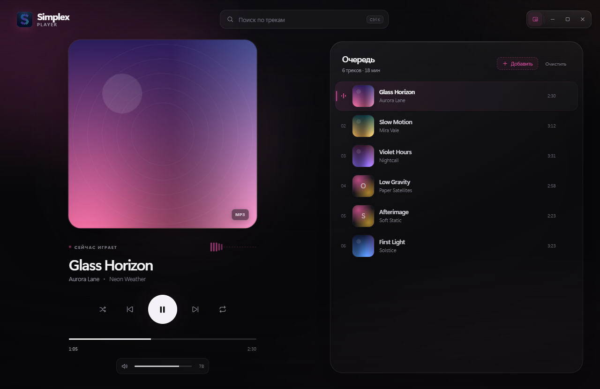

# Simplex player

Минималистичный локальный музыкальный плеер для рабочего стола. Перетащите папку или отдельные треки — Simplex соберёт очередь, прочитает теги и обложки, подстроит цвет интерфейса под текущий альбом и начнёт играть.

## Скачать

Готовые сборки — на странице [Releases](https://github.com/TViN-X/simplex-player/releases/latest):

- **Windows** — установщик или portable;
- **macOS** — универсальный `.dmg` для Intel и Apple Silicon;
- **Linux** — `.AppImage` или `.deb`.

Сборки не подписаны: Windows SmartScreen и macOS Gatekeeper могут показать предупреждение. Музыка остаётся на диске и никуда не загружается.

## Возможности

- **Drag & drop** — папки с подпапками или отдельные файлы.
- **Форматы** — MP3, FLAC, WAV, AAC/M4A, OGG, OPUS и другие, которые поддерживает Chromium.
- **Очередь** — поиск, переход к треку, удаление и очистка списка.
- **Плеер** — play/pause, перемотка, громкость, mute, shuffle и повтор.
- **Обложки и цвет** — встроенные обложки и акцент интерфейса под текущий альбом.
- **Мини-плеер** — компактная плашка с управлением, полосой прогресса и живым фоном из цветов обложки; положение запоминается, есть режим «поверх окон».
- **Продолжение с места** — громкость, режимы, последний трек и позиция сохраняются.
- **Только локально** — без аккаунтов, сети и загрузок.

## Интерфейс

### Основное окно



### Мини-плеер


Мини-плеер вызывается кнопкой рядом с управлением окном. Длинные названия прокручиваются, громкость открывается по наведению на mute, а прогресс можно перематывать прямо по нижней кромке.

## Горячие клавиши

| Действие | Клавиши |
| --- | --- |
| Играть / пауза | `Space` |
| Перемотка ±5 / ±30 сек | `←` `→` / `Shift` + `←` `→` |
| Громкость / mute | `↑` `↓` / `M` |
| Следующий / предыдущий | `N` / `P` |
| Поиск | `Ctrl` + `K` |
| Добавить папку / файлы | `Ctrl` + `O` / `Ctrl` + `Shift` + `O` |

На macOS вместо `Ctrl` — `⌘`.

## Запуск из исходников

Нужен Node.js 18+.

```bash
npm install
npm start
```

## Лицензия

MIT
