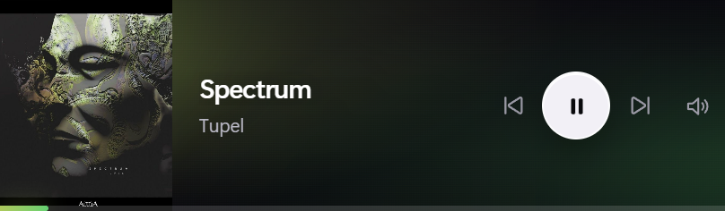

# Simplex player

Минималистичный локальный музыкальный плеер для рабочего стола. Перетащите папку или отдельные треки — Simplex соберёт очередь, прочитает теги и обложки, подстроит цвет интерфейса под текущий альбом и начнёт играть.


## Возможности

- **Drag & drop**: папка целиком (с подпапками) или отдельные файлы.
- **Форматы**: MP3, FLAC, WAV, AAC/M4A, OGG, OPUS и другие, которые поддерживает Chromium.
- **Очередь**: поиск, переход к треку, удаление, «показать в проводнике», очистка списка. Кнопка **«Добавить»** встроена прямо в шапку плейлиста.
- **Мини-плеер**: кнопка рядом с управлением окном превращает окно в компактную плашку-виджет. В ней обложка, бегущее название, кнопки трека, mute со всплывающим ползунком громкости и полоса прогресса по нижнему краю. Фон плашки подстраивается под цвет обложки и живёт, пока играет музыка; положение окна запоминается, а закрепление поверх других окон можно отключить.
- **Свои элементы окна**: свернуть, развернуть и закрыть — собственные кнопки с отдельной подложкой, а не системная полоса.
- **Бегущие названия**: длинный заголовок плавно прокручивается в основном плеере и в мини-плеере; короткий остаётся на месте.
- **Управление**: play/pause, следующий/предыдущий, перемотка, громкость, mute, shuffle, повтор очереди и одного трека. Громкость находится в секции плеера.
- **Обложки и акценты**: встроенные обложки извлекаются в кэш, а доминирующий цвет обложки становится акцентом интерфейса.
- **Живой визуализатор**: анализ звука через Web Audio API.
- **Продолжение с места**: запоминаются громкость, режимы, последний трек и позиция.
- **Анимации**: плавные переходы обложек, ambient-подсветка, reduced-motion поддержка.
- **Только локально**: файлы не копируются и никуда не отправляются; сеть не используется.

## Запуск

Нужен [Node.js](https://nodejs.org/) 18+ и npm.

```bash
npm install
npm start
```

Для отладки с открытыми DevTools:

```bash
npm run dev
```

Приложение работает на Windows, macOS и Linux. На macOS остаются системные «светофоры», а кнопка мини-плеера — в правом верхнем углу.

## Как пользоваться

1. Нажмите **«Добавить»** в шапке очереди → «Добавить папку» или «Добавить файлы».
2. Либо перетащите папку/файлы прямо в окно.
3. Клик по треку в очереди запускает его; повторный клик ставит на паузу.

Первый добавленный трек запускается автоматически. Если закрыть приложение, при следующем запуске последний трек восстановится на паузе с сохранённой позицией.

### Мини-плеер

Кнопка с иконкой маленького окна (слева от кнопок свернуть/развернуть/закрыть) переключает окно в режим виджета:



- окно уменьшается до компактной горизонтальной плашки без внутренних карточек — фон, обложка и управление составляют одно целое;
- фон плашки собирается из цветов обложки: пока играет музыка, он медленно движется и дышит, а на паузе замирает;
- внутри — обложка, название с прокруткой, исполнитель, предыдущий трек, play/pause, следующий трек и mute;
- при наведении на mute всплывает горизонтальный ползунок громкости с текущим значением;
- прогресс трека показан тонкой линией по нижнему краю окна; по ней можно перематывать;
- позиция мини-окна запоминается и восстанавливается при следующем запуске;
- кнопки в правом верхнем углу (появляются при наведении): галочка «Поверх окон», разворот плеера и закрытие. Галочка включена по умолчанию и отключает закрепление окна поверх остальных.

### Горячие клавиши

| Действие | Клавиши |
| --- | --- |
| Играть / пауза | `Space` |
| Перемотка ±5 сек | `←` / `→` |
| Перемотка ±30 сек | `Shift` + `←` / `→` |
| Громкость | `↑` / `↓` |
| Mute | `M` |
| Перемешивание | `S` |
| Повтор (выкл → всё → один) | `R` |
| Следующий / предыдущий | `N` / `P` |
| Поиск | `Ctrl` + `K` |
| Добавить папку / файлы | `Ctrl` + `O` / `Ctrl` + `Shift` + `O` |
| DevTools | `F12` |

На macOS `Ctrl` заменяется на `⌘`.

### Контекстное меню трека

Правый клик по строке или кнопка `⋯`:

- **Играть / Пауза**
- **Показать в проводнике** — открывает папку с файлом.
- **Убрать из очереди** — удаляет трек из библиотеки (сам файл остаётся на диске).

Кнопка **«Очистить»** в шапке очереди очищает весь список. Она работает в два шага: первый клик переводит в режим подтверждения («Удалить всё?»), второй — очищает. Отмена — `Esc` или клик в другом месте.

## Поддерживаемые форматы

`.mp3`, `.flac`, `.wav`, `.wave`, `.ogg`, `.oga`, `.opus`, `.m4a`, `.m4b`, `.mp4`, `.aac`, `.webm`, `.aif`, `.aiff`

Фактическое воспроизведение зависит от кодеков, встроенных в Electron/Chromium. Например, ALAC в `.m4a` может не проигрываться на некоторых сборках, а FLAC и OPUS поддерживаются.

## Где хранятся данные

Всё лежит в системной папке `userData` приложения:

- **Windows**: `%APPDATA%\Simplex player`
- **macOS**: `~/Library/Application Support/Simplex player`
- **Linux**: `~/.config/Simplex player`

| Файл | Назначение |
| --- | --- |
| `library.json` | Список путей и даты добавления |
| `metadata-cache.json` | Кэш тегов, длительности и обложек |
| `settings.json` | Громкость, режимы, последний трек и позиция |
| `window-state.json` | Размер и положение окна |
| `covers/` | Извлечённые обложки в JPEG |

Удаление папки `Simplex player` сбрасывает плеер к первому запуску. Сами музыкальные файлы не затрагиваются.

## Как устроено

- **Electron** — окно и доступ к файловой системе.
- **Ванильный HTML/CSS/JS** — без фреймворков и сборки.
- **Кастомная схема `simplex://`** — отдаёт приложение, обложки и аудио. Для аудио реализованы HTTP Range-запросы, поэтому перемотка работает без загрузки файла целиком.
- **`music-metadata`** — чтение тегов и встроенных обложек.
- **Web Audio API** — анализатор спектра для визуализатора.
- **Своя рамка окна** — `frame: false` на Windows/Linux, перетаскиваемая шапка и собственные кнопки управления; на macOS — системные «светофоры».
- **Безопасность** — `contextIsolation`, `sandbox`, отключён `nodeIntegration`, CSP, запрет навигации и внешних окон.

```
electron/
  main.js       окно, мини-плеер, IPC, жизненный цикл
  preload.js    мост contextBridge (window.simplex)
  library.js    сканирование, метаданные, обложки, кэш
  settings.js   настройки и их валидация
  protocol.js   схема simplex:// и стриминг аудио
app/
  index.html    разметка
  styles.css    дизайн-система и анимации
  app.js        вся логика интерфейса и плеера
assets/
  icon.png      иконка приложения
```

## Лицензия

MIT
